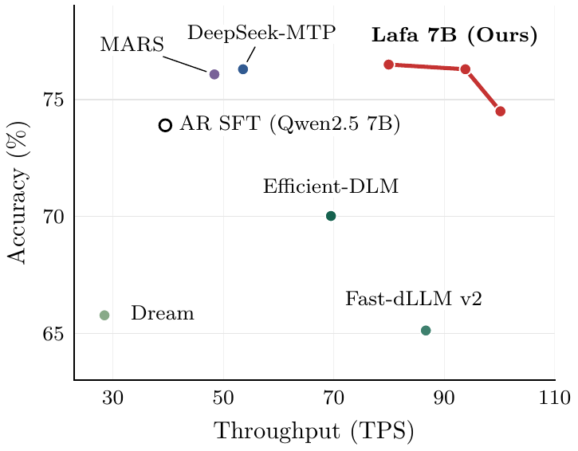

<div align="center">

# Large Flow Language Models

### One model. Three ways to decode.

`next-token` · `parallel flow` · `self-speculative`

[](#citation)
[](https://huggingface.co/lafa-hf/models)
[](docs/inference.md)
[](LICENSE)

**Arnav Chavan**<sup>1,2,&#42;</sup> ·
**Chanhyuk Lee**<sup>3,&#42;</sup> ·
**Udbhav Bamba**<sup>1,&#42;</sup> ·
**Jaehoon Yoo**<sup>3</sup> ·
**Seunghoon Hong**<sup>3</sup> ·
**Aditi Raghunathan**<sup>4,†</sup> ·
**Jinwoo Kim**<sup>3,†</sup>

<sub>
<sup>1</sup> Amazon · <sup>2</sup> UC Berkeley · <sup>3</sup> KAIST ·
<sup>4</sup> Carnegie Mellon University<br>
<sup>&#42;</sup> Equal contribution · <sup>†</sup> Equal advising
</sub>

</div>

---

**Lafa** converts pretrained autoregressive models into block flow language
models. The same weights support standard next-token prediction, parallel
block generation, and self-speculative decoding.

<table>
  <tr>
    <td align="center" width="33%">
      <strong>2.54×</strong><br>
      AR throughput at matched or better quality
    </td>
    <td align="center" width="33%">
      <strong>3 modes</strong><br>
      NTP · flow · self-spec
    </td>
    <td align="center" width="33%">
      <strong>0.5B–8B</strong><br>
      released checkpoints
    </td>
  </tr>
</table>

<p align="center">
  
</p>

## Results

<p align="center">
  
</p>

<p align="center">
  <strong>Quality + speed:</strong>
  Lafa 7B reaches 2.54× AR throughput at matched or better quality.
</p>

## Models

| Backbone | Size | Block | Model |
|---|---:|---:|---|
| Qwen2.5 Instruct | 0.5B | 4 | [🤗 `lafa-hf/lafa-0.5B`](https://huggingface.co/lafa-hf/lafa-0.5B) |
| Qwen2.5 Instruct | 7B | 4 | [🤗 `lafa-hf/lafa-7B`](https://huggingface.co/lafa-hf/lafa-7B) |
| Qwen3 Base | 8B | 4 | [🤗 `lafa-hf/lafa-8B`](https://huggingface.co/lafa-hf/lafa-8B) |

## Quick start

```bash
git clone https://github.com/lafa-gh/large-flow-lms.git
cd large-flow-lms
pip install -r requirements-inference.txt
```

```python
import torch
from transformers import AutoModelForCausalLM, AutoTokenizer

repo = "lafa-hf/lafa-0.5B"
tokenizer = AutoTokenizer.from_pretrained(repo, trust_remote_code=True)
model = AutoModelForCausalLM.from_pretrained(
    repo,
    trust_remote_code=True,
    dtype=torch.bfloat16,
).to("cuda").eval()

text = tokenizer.apply_chat_template(
    [{"role": "user", "content": "What is 17 + 25?"}],
    tokenize=False,
    add_generation_prompt=True,
)
inputs = tokenizer(
    text,
    add_special_tokens=False,
    return_tensors="pt",
).to("cuda")

output = model.generate(
    **inputs,
    gen_mode="flow",
    num_steps=4,
    noise_scale_override=0.1,
    cfg_scale=1.0,
    max_new_tokens=128,
)

print(tokenizer.decode(
    output[0, inputs.input_ids.shape[1]:],
    skip_special_tokens=True,
))
```

Change one argument to switch decoding:

| Mode | Argument |
|---|---|
| Parallel flow | `gen_mode="flow"` |
| Next-token prediction | `gen_mode="ar"` |
| Self-speculative | `gen_mode="speculative"` |

## Guides

| | |
|---|---|
| [**Inference**](docs/inference.md) | Modes, batching, and checkpoint options |
| [**Training**](docs/training.md) | Convert or continue training a Lafa model |
| [**Distillation**](docs/distillation.md) | Train a few-step flow map |
| [**Evaluation**](docs/evaluation.md) | Run benchmarks and checkpoint checks |

## Citation

```bibtex
@misc{chavan2026largeflow,
  title  = {Large Flow Language Models},
  author = {Arnav Chavan and Chanhyuk Lee and Udbhav Bamba and Jaehoon Yoo
            and Seunghoon Hong and Aditi Raghunathan and Jinwoo Kim},
  year   = {2026},
  url    = {https://github.com/lafa-gh/large-flow-lms}
}
```
