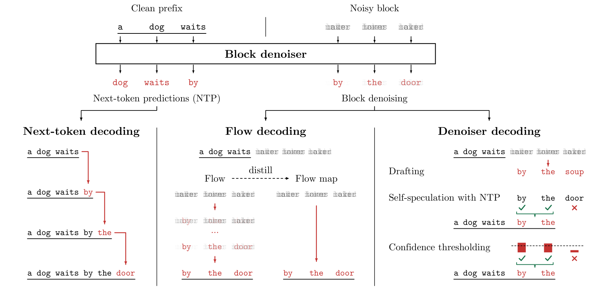

# Large Flow Language Models

**Arnav Chavan**<sup>1,2,&#42;</sup>, **Chanhyuk Lee**<sup>3,&#42;</sup>,
**Udbhav Bamba**<sup>1,&#42;</sup>, **Jaehoon Yoo**<sup>3</sup>,<br>
**Seunghoon Hong**<sup>3</sup>, **Aditi Raghunathan**<sup>4,†</sup>,
**Jinwoo Kim**<sup>3,†</sup>

<sup>1</sup> Amazon · <sup>2</sup> UC Berkeley · <sup>3</sup> KAIST ·
<sup>4</sup> Carnegie Mellon University

<sup>&#42;</sup> Equal contribution · <sup>†</sup> Equal advising


[](https://huggingface.co/lafa-hf/models)


Official implementation of **Large Flow Language Models**.
**Lafa** converts pretrained autoregressive models into block flow language models
at 0.5B, 7B, and 8B scales. A single model supports next-token prediction,
parallel flow, and self-speculative decoding; distillation enables few-step flow maps.



## Models

| Backbone | Model repository |
| --- | --- |
| Qwen2.5 0.5B Instruct | [lafa-hf/lafa-0.5B](https://huggingface.co/lafa-hf/lafa-0.5B) |
| Qwen2.5 7B Instruct | [lafa-hf/lafa-7B](https://huggingface.co/lafa-hf/lafa-7B) |
| Qwen3 8B Base | [lafa-hf/lafa-8B](https://huggingface.co/lafa-hf/lafa-8B) |

## Quick start

```bash
git clone https://github.com/lafa-gh/large-flow-lms.git
cd large-flow-lms
pip install -r requirements-inference.txt
```

The example uses a CUDA GPU and greedy generation. Model code is included with
the Hugging Face checkpoint.

```python
import torch
from transformers import AutoModelForCausalLM, AutoTokenizer

repo = "lafa-hf/lafa-0.5B"
tokenizer = AutoTokenizer.from_pretrained(repo, trust_remote_code=True)
model = AutoModelForCausalLM.from_pretrained(
    repo, trust_remote_code=True, dtype=torch.bfloat16
).to("cuda").eval()
text = tokenizer.apply_chat_template(
    [{"role": "user", "content": "What is 17 + 25?"}],
    tokenize=False, add_generation_prompt=True,
)
inputs = tokenizer(text, add_special_tokens=False, return_tensors="pt").to("cuda")
output = model.generate(
    **inputs, gen_mode="flow", num_steps=4, cfg_scale=1.0,
    noise_scale_override=0.1, max_new_tokens=128,
)
print(tokenizer.decode(output[0, inputs.input_ids.shape[1]:], skip_special_tokens=True))
```

Use `gen_mode="speculative"` for self-speculative decoding or `gen_mode="ar"`
for next-token prediction. See the [inference guide](docs/inference.md) for
other modes, batching, and checkpoint options.

## Training and evaluation

- [Training](docs/training.md): convert an AR backbone or continue training a Lafa checkpoint.
- [Distillation](docs/distillation.md): train a flow-map student for few-step generation.
- [Evaluation](docs/evaluation.md): run benchmarks and checkpoint checks.

## Citation

```bibtex
@misc{chavan2026largeflow,
  title  = {Large Flow Language Models},
  author = {Arnav Chavan and Chanhyuk Lee and Udbhav Bamba and Jaehoon Yoo
            and Seunghoon Hong and Aditi Raghunathan and Jinwoo Kim},
  year   = {2026},
  url    = {https://github.com/lafa-gh/large-flow-lms}
}
```
